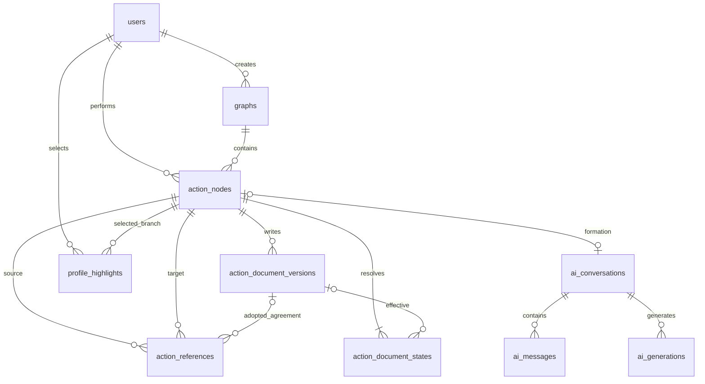

# 引序数据库设计 V1

状态：首版领域设计，面向 MySQL 8.4 LTS。持久化已转为 Go/GORM 模型及显式版本迁移；实际接入范围与验证证据见 [后端实施计划](backend-implementation-plan.md)。不再维护纯 SQL 建表文件。

本稿依据当前 `ActionNode`、发布 DTO、表达／约定继承选择器、模拟接口和请求契约设计。数据库采用表内自增主键，表间引用和公开资源标识统一使用 UUID，不建立数据库外键；不把前端整个对象原样塞进 JSON。

## 1. 业务范围

- 一次行动是已经发生的一次经历，不包含计划、目标、进行中或完成状态。
- 一条主要承接来源决定表达和后续约定的继承；额外合入来源只扩展事实上下文。
- 表达通过既有 AI 连续对话整理及确认，不提供通用写作编辑器或多人协作编辑模型。
- 本节点向后的约定，与本节点引用上游时的约定核对，是两份不同数据。
- 未核对、不满足均可发布；没有申请、批准或来源作者同意表。
- 首页最多精选五个表达分支，顺带展示该分支有效约定；仅在编辑精选集中增删、排序。
- 未发送输入、视图位置等草稿仍在浏览器 IndexedDB。服务端只保存实际提交的对话和生成记录，不将本地草稿自动变成云端文稿。
- 不为旧计划／完成模型、点赞／存疑、私信或用户 AI Key 建表。

## 2. 存储约定

| 项目 | V1 约定 |
| --- | --- |
| 数据库 | MySQL 8.4 LTS，InnoDB；不可用 SQLite 的行为代替 MySQL 验证 |
| 字符集 | 正文 `utf8mb4_0900_as_cs`；UUID、标识、存储键用 `ascii_bin` |
| 主键 | `id BIGINT UNSIGNED AUTO_INCREMENT`；仅用于表内主键及内部遍历，API 不返回它，其他表不引用它 |
| 表间关联 | 引用目标表唯一的 `uuid`，关联字段统一为 `*_uuid CHAR(36) CHARACTER SET ascii COLLATE ascii_bin` |
| 公开身份 | 可独立寻址的用户、图、行动、引用、文档版本、文件、对话、生成使用服务端 UUID |
| 时间 | `DATETIME(6)`；连接时区强制 `+00:00`，API 转为带 `Z` 的 ISO 8601 |
| 并发版本 | `INT UNSIGNED`，从 1 开始，更新带 `expectedVersion`；溢出要明确报错 |
| 空文档 | 请求仍用 `inherit/update/clear`；不把 `NULL`、空字符串和继承混同 |
| 逻辑关联 | 不创建 FOREIGN KEY；目标存在性、同图归属、类型和删除一致性由 application 用例在事务中保证 |
| 索引与检查 | 保留 PRIMARY KEY、UNIQUE、普通索引及单行 CHECK；关联查询需要的索引显式定义，不依赖外键自动建索引 |
| 结构变更 | 有版本记录的 Go/GORM 迁移，由独立管理命令执行；API 启动不运行 AutoMigrate |

部署者选好独立库后再运行迁移；仅显式的 `--create-database` 管理选项可创建 schema。所有 `uuid` 的合法格式、大小写规范化均由服务端校验，不允许客户端指定新业务资源的身份。

例如 `action_nodes.graph_uuid = graphs.uuid`、`action_nodes.author_uuid = users.uuid`。关联查询不经过自增 `id`；单表列表索引末尾的 `id` 只用于稳定排序和内部遍历，公开游标必须封装处理。关系表无需再分配可寻址 UUID 时，以组合业务唯一键定位，不把其自增主键当作关联标识。

## 3. 表与关系

共 20 张业务表，其中 6 张构成主要业务数据：`users`、`graphs`、`action_nodes`、`action_document_versions`、`action_document_states`、`action_references`。其余承接账户、AI、关注、精选、图片及提交可靠性。另有 `schema_versions`、`seed_imports`、`legacy_aliases` 三张运维表，记录版本、导入批次及演示短 ID 的 UUID 映射。

图中的连线均为 UUID 逻辑关系，不代表数据库外键。“每节点两行状态”“每已发布节点一段形成对话”是发布事务的不变量，不是所有基数都能通过单行 CHECK 表达。

### 3.1 账户与图片

| 表 | 职责与重要约束 |
| --- | --- |
| `users` | 公开昵称、性别、简介、头像及封面；`version` 同时保护资料与精选更新；`is_test_account`、`test_dataset` 在数据库标记测试用户及归属批次，不进入公开资料 |
| `user_credentials` | 用户一对一凭据、唯一规范化邮箱、Argon2id 编码串、认证版本；公开资料查询禁止带出 |
| `media_assets` | 文件归属、对象键、真实类型、尺寸、内容哈希及上传状态；ready 前禁止业务引用 |

首版邮箱限定 ASCII，账号匹配规则为去首尾空白、整个地址转小写，不折叠点号或加号别名。注册验证码通过后才创建 `users` 和 `user_credentials`；更换邮箱必须验证并在同一事务更新。该规则应同步到认证接口，而不是只依赖数据库唯一键。

密码、邮箱重置时递增 `auth_version`。会话请求需要核对当前账户状态和该版本（或可靠地失效全部会话）；只在 Redis 会话里保存旧版本不能自行保证撤销有效。

`media_assets` 不存平台密钥或临时签名 URL。头像／封面为空时使用前端默认展示；图片本体放对象存储，实际可用 URL 由读取接口根据对象键构造。

### 3.2 图与行动

| 表 | 职责与重要约束 |
| --- | --- |
| `graphs` | 公共空间、创建者、图资料、AI 指引、节点编号计数器、资料版本、删除标记 |
| `action_nodes` | 实际行动者、标题、不可任意改写的行动事实、稳定编号、层级、背景数量、发布指引快照 |

`UNIQUE(graph_uuid, node_number)` 防止编号重复；生成列 `root_graph_uuid` 的唯一键保证每图最多一个起点。创建空图时不插入行动。

参与人从实际行动作者去重计算，不建立可由客户端任意改动的 `participantIds` 数组，也不把关注当作参与。只有创建者的空图仍可被“我发起的”查询读到。

层级、历史数量是发布时由服务端计算的投影，可由引用关系重建；节点编号不能重排。`updated_at` 不冒充行动发布时间，图资料变更也不改变最近行动排名。

V1 的字段上限提案包括行动标题 200 字、昵称 30 字、图标题 60 字、图简介 240 字。正文类型提供存储容量，不代表允许无限请求；行动／文档／消息建议各最多 64 KiB UTF-8，整次 JSON 最多 1 MiB，图片单文件最多 10 MiB、最多 4000 万像素。这些是待接入时统一到前后端常量的首版配置，不是既有功能已实现的限制。

### 3.3 表达和约定：版本与状态分开

| 表 | 职责与重要约束 |
| --- | --- |
| `action_document_versions` | 不可覆盖的正文版本，记录 expression/agreement、update/clear、操作人、时间、上一有效版本和真实生成来源 |
| `action_document_states` | 每节点 expression/agreement 各一行，记录当前处理意图、本地版本及有效版本指针 |

| 当前 mode | local_version_uuid | effective_version_uuid | 含义 |
| --- | --- | --- | --- |
| `update` | 本节点非空版本 | 同一本地版本 | 本节点设置或更新正文 |
| `clear` | 本节点空版本 | 同一本地版本 | 主动清空，留下可追溯的清空记录 |
| `inherit` | NULL | 主要来源当时的有效版本，可能是 clear 版本或 NULL | 不复制正文、不越过清空寻找更早内容 |

只有明确更新或清空才新增版本；版本不 UPDATE 覆盖。更改本节点表达时，不改行动事实，也不把历史来源版本改成新内容。

有效版本指针是有明确来源约束的读取投影，不是新的业务事实。引用建立前，来源状态和版本必须在同一事务中重查；建立引用后，来源节点不可继续修改表达或约定，因此继承指针不会在背后漂移。

`previous_version_uuid` 只能指向已有的、同图同类且真实相关的旧版本；应用必须在同一事务中按 UUID 读取并检查存在性、图、文档类型、时间方向及来源链，防止伪造来源或循环。数据库不提供跨表存在性或归属保证。

`actor_uuid` 是真实确认者的审计字段，不代表存在协作功能。表达版本必须关联相应用户已成功生成的 AI 结果；约定允许现有手动补充／修改／清空，不伪造 AI 对话。

### 3.4 引用关系固定当时采用的约定

`action_references` 的一行是一条来源行动到后续行动的真实箭头，包含：来源与目标、`primary/merged` 类型、采用的来源节点版本、固定的约定版本、四态核对及不符合原因。

- 同一对来源／目标只能有一条箭头；同一目标最多一条 `primary`，额外来源为 `merged`。
- `source_node_uuid`、`target_node_uuid` 分别逻辑关联 `action_nodes.uuid`，`agreement_version_uuid` 关联 `action_document_versions.uuid`。
- 应用在图锁内重新读取来源、目标，验证两者都属于 `graph_uuid`，且来源实际编号小于目标实际编号，阻止跨图引用与环；UUID 本身没有行动先后语义。
- 引用表不再冗余来源／目标编号和固定 agreement 类型列。编号及约定类型从真实记录核验，不由前端自由指定。
- `unrestricted` 表示有效约定为空（可能采用 clear 版本）；`unreviewed` 表示存在约定但未核对；`satisfied` 表示满足；`exception` 表示不满足且必须有原因。
- 所采用的约定版本即使是继承的，也保留原提出者 `action_document_versions.actor_uuid`，不归给中间传递者。
- 回应流只读取满足非空约定、来源与回应行动作者不同、回应者又不同于约定实际提出者的箭头。

API 的 `complies: true/false/null` 映射为上述核对状态；不能仅凭非空约定判断满足。数据库无需存一张重复的“约定回应表”，内容流可以从引用与版本联表得到。

例子：

| 节点 | 表达 | 向后约定 | 本次引用核对 |
| --- | --- | --- | --- |
| A 起点 | 写入 E1 | 写入 G1 | 无来源 |
| B 承接 A | 继承 E1 | 继承 G1 | A → B 固定 G1 |
| C 承接 B | 写入 E2 | 清空为 G2 | B → C 仍固定 G1，可以记录满足 |
| D 承接 C | 继承 E2 | 继承空版本 G2 | C → D 为 unrestricted，不退回 G1 |

如果 C 被选入主页，展示 E2 和 C 当前的空约定；不会把来源核对里的 G1 当作 C 向别人提出的约定。

### 3.5 AI 对话与确认边界

| 表 | 职责与重要约束 |
| --- | --- |
| `ai_conversations` | 一段行动整理对话，发布后绑定一个节点，后续表达仍在同一段对话追加 |
| `ai_messages` | 实际用户／AI 消息及顺序，正文只追加；`confirmed_at` 区分可公开内容 |
| `ai_generations` | 一次生成的真实发起人、模式、状态、模型、提示词版本、文稿、背景签名、用量与确认状态 |
| `ai_generation_messages` | 本轮实际送入模型的有序消息清单，避免失败或被放弃的轮次混入上下文 |
| `ai_generation_sources` | 每次生成实际采用的直接来源、节点版本、表达／约定版本及各项核对结果 |

这五张表服务现有“行动整理 → 确认发布 → 连续对话更新表达”流程，不是聊天产品或通用在线文稿。创建一个未发布对话不会创建行动、参与记录或公开内容。

对话的 `owner_uuid` 记录最初创建者，每轮生成的 `requested_by_uuid` 记录实际发起人，用户消息另记实际作者。这些字段用于归属与追溯，不以“对话由谁创建”替代终点表达操作资格；读取私有生成、发起生成和确认结果仍须分别通过 application 用例授权。

未发送输入和 UI 草稿仍只在本地。服务端生成记录可在用户离开后保留私有数据，但不能以此承诺已实现跨设备草稿恢复。

发布第一次行动时，固定 `published_through_sequence`，以后不移动这个原始对话边界。原始 conversation 读取已确认且序号不超过边界的消息；expressionConversation 读取已确认且位于边界之后的消息。尚未确认、失败或被放弃的输入和结果不出现在公开形成过程中；公开生成查询只允许 `confirmed_at IS NOT NULL`。

每轮的完整实际上下文由明确消息清单、直接来源及文档版本、不可改写的祖先事实、指引快照和提示词版本重建。不能仅凭 `input_through_sequence` 拼接所有旧消息。

同一对话最多一条 pending 生成；失败重试可复用原用户消息，新的实际模型尝试使用新的 request_key。网络结果不确定时先按原 request_key 查询，不能不经确认再次计费调用。pending 超时由恢复任务标为失败／取消；后端重启后不得无限占位。

AI 网络调用不在数据库事务中。成功生成仍不是发布；确认时重新核对来源、节点版本和编辑资格。允许用户独立修改向后约定，不能因此改写本次来源核对。表达核对和事实的确认仍以这次明确采用的生成结果为准。

### 3.6 关注、精选、幂等

| 表 | 职责与重要约束 |
| --- | --- |
| `user_follows` | 用户关注的唯一关系，禁止关注自己 |
| `graph_follows` | 用户关注图的唯一关系，应用验证图可用且已有行动 |
| `profile_highlights` | 用户、具体节点、1～5 顺序；每用户顺序唯一、节点唯一，因此最多五项 |
| `idempotency_records` | 账号＋命令＋提交键唯一，记录请求指纹与原始确认响应，和业务写入同事务落库 |

精选允许沿用本人表达的本人分支，但不允许把他人表达归到本人主页。保存时按当前完整事实验证，不能只检查节点作者；有效表达的实际来源作者同样必须是本人。SQL 无法仅靠单表 CHECK 完成该判断。

精选只保存节点，约定和表达都由节点的当前有效版本读取。后续接续和分叉不会移动所选节点；节点的有效表达清空或图删除后不再展示，重新编辑时去除失效项。不持久化一个可能与正文不同步的精选文稿副本。

集中保存精选时锁定用户资料行，检查 `users.version`，验证全部候选，再删除该用户旧精选并按 1～N 插入，最后递增版本。所有步骤在一个事务中；任何失败回滚。这样避免逐个交换位置触发唯一键冲突，也保持取消编辑不写库。

幂等表的 `response_json` 是有意采用的动态 JSON：不同命令需要重放不同公开 DTO。它不是业务事实的主存储；不得保存密码、平台凭据或会话 token。相同键不同内容返回冲突，至少保留 24 小时。

### 3.7 图片关联

`action_images` 保存行动附图；站内文件使用 `asset_uuid`，演示数据中的外链使用 `external_url`，CHECK 保证恰好设置其中一个，外链不会伪装成站内上传。`document_images` 保存具体表达／约定版本引用的站内文件；`profile_biography_images` 保存简介引用的站内文件。三者都保留位置与描述，允许同一图片在正文中有意多次出现。

行动与表达预览兼容现有节点图片来源；约定预览必须使用该约定版本实际 Markdown 中的图片，不能借用回应行动附图。读取时仍由 Markdown 图片解析器处理内联位置和重复展示，关联表不额外重复追加图片。

站内 Markdown 使用服务端生成的稳定资源地址，由上传结果映射 asset UUID。外链图片仍是外链，不伪造成本人上传资产；后端不为任意外链自动抓取文件。简介或文档确认保存时同步抽取站内引用关系，避免清理任务误删仍被使用的文件。

## 4. 数据库能保证什么，应用还要保证什么

| 数据库约束 | 应用事务还必须保证 |
| --- | --- |
| 同图节点编号唯一、最多一个起点 | 非起点必须有且只有一个主要承接；起点无引用；计数器正确分配 |
| 引用来源／目标组合唯一、最多一条主要来源 | UUID 对应节点存在且同图，来源实际编号小于目标；合入只能选择允许的终点，排除已知历史，主要来源允许从旧节点分叉 |
| 每节点每类状态唯一，update/clear 的本地和有效指针相等 | 节点和版本存在且同图同类；local 版本确属本节点且 mode 一致；inherit 确实来自主要来源；每节点正好两行 |
| 核对状态枚举、非 unrestricted 必须有约定版本 UUID、不满足必须有原因 | 约定版本存在且类型为 agreement，正是来源当时有效版本；空正文只可 unrestricted；非空不得伪装 unrestricted |
| 精选最多五项且不重复 | 本人分支上的本人有效表达，图未删除，顺序连续 |
| UUID 唯一，关联字段非空规则及必要索引 | 所有逻辑关联对象存在且可用；当前用户有操作资格；公开接口不泄露凭据或未确认对话 |
| pending 生成唯一、对话内消息序号唯一、生成输入位置唯一 | 消息、生成确属同一对话；图归属及版本类型正确，源自真实背景，用户消息归属正确，AI 输出不能由客户端伪造 |

V1 不提供通用写作／协作接口。节点作者、文档操作人只是必要的业务归属和追溯字段。图资料现有的创建者／参与排序资格以及终点文档操作权限，由后续用例按确认的产品规则实现，不因本次建表自动扩张或收紧权限。

数据库的版本表“不可覆盖”、事实正文“不可任意修改”是仓储写入接口与业务事务的不变量。实际应用只暴露明确发布、表达确认和约定更新方法，不提供通用表写入入口。没有外键意味着直接执行 SQL 不会自动阻止悬空关联，维护脚本同样必须遵守关联检查和锁顺序。

## 5. 事务流程

### 5.1 发布行动

1. 在事务中创建／锁定账号、命令和 Idempotency-Key 对应记录。已有成功响应先按请求指纹重放；不再用当前来源状态否定已完成提交。
2. 获取用户的兼容读锁并检查账户状态，然后获取图的 `FOR UPDATE` 锁。所有同图发布、文档更新、图资料更新和删除遵循同样的锁规则。
3. 检查图可用、生成已成功且属于当前用户／对话，来源和文档背景与确认输入一致；重新校验全部 sourceVersions、合入资格及历史并集。已发布生成不能换内容再次使用。
4. 从 `graphs.next_node_number` 分配编号并递增；生成节点 UUID；插入行动、明确写入的文档版本、两行文档状态和全部直接引用。
5. 在服务端固定引用采用的约定版本，写入每个来源真实核对结果；计算层级、历史数及指引快照。
6. 关联原始对话及确认生成，标记本轮实际采用消息与 AI 回复已确认；保存当前允许的图片关联。
7. 将幂等记录改为 succeeded 并保存公开响应，统一提交。processing 占位不得先单独提交；出错则连同节点和编号分配一起回滚。

只有业务事务会锁图，等待 AI 回复期间不锁图。新节点新增引用，或另一人刚修改过来源时，确认操作需返回版本冲突，保留前端草稿供重新整理。

### 5.2 确认表达或更新约定

按同图锁顺序检查账户、节点版本、操作权限，以及不存在任何以本节点为来源的承接／合入。旧节点仍允许被接续，但已有后续引用的节点不再改文档。

表达确认必须使用该节点连续对话中的成功生成；约定更新使用现有手动设置流程。新增明确文档版本，更新该节点对应状态和节点 version，记录确认时间；不更新行动事实、来源引用或别人的文档。

### 5.3 保存精选与删除图

精选写入先按用户 UUID 锁用户行，再按图 UUID 的 ascii_bin 顺序锁定候选涉及的图，之后重新验证并整体替换。用户行锁也由同用户资料更新遵守；其他同图写入持有用户兼容读锁，避免“先锁图、后等精选用户行”的死锁方向。

删除图须在图锁内复核创建者、实际参与作者、可删除资格、expectedVersion 和 expectedNodeCount。确认后设置 deleted_at，清除图关注并让全部公开查询排除其节点、表达、引用与统计；保留版本和引用供内部一致性及后续保留期处理。

不增加前台恢复入口；逻辑删除是服务端存储策略，不承诺用户可撤销删除。跨领域物理清理和对象存储删除是另外的维护流程，不能在 HTTP handler 中逐表级联删除。

所有新增逻辑关联必须与目标删除采用一致的锁规则：关注图也要在用户锁、图锁内重查可用性；绑定图片与图片清理按资源 UUID 顺序锁定文件行，重查 ready 状态及全部使用关系，先标记不可再引用再删除对象。删除任何被关联记录前须显式检查并处理关联，不依赖数据库报错兜底。账户物理删除不在 V1 业务入口中。

## 6. 读取与索引

- 行动列表：`action_nodes(graph_uuid, created_at, id)`；个人时间线：`(author_uuid, created_at, id)`，均排除已删除图。
- 表达列表：先在全图判断 `NOT EXISTS (SELECT 1 FROM action_references r WHERE r.source_node_uuid = node.uuid)`，再按作用域和作者筛选，联表读取 expression 的非空有效版本；不能先筛作者再找终点。
- 发现表达按节点发布时间排序；关注表达可按本节点 expression 状态更新时间与发布时间较大者排序，不能使用祖先表达的时间，也不能被约定修改重新排序。
- 约定回应：从 `action_references` 的 satisfied 索引进入，联表固定版本、来源作者和回应者；按回应行动发布时间加唯一引用 ID 排序，保留双向参与者筛选。
- 精选：按 `(user_uuid, position)` 读取节点的两行有效状态及版本；五条即可组合出首页，不拉全站行动。
- 活跃图：按图内真实行动的最后发布时间聚合；参与人按行动作者去重。统计不是独立可由客户端提交的事实。
- 热力图：以 UTC 范围查询，再按请求明确的 IANA 时区聚合本地自然日；不固化一份 UTC 日期计数冒充所有用户的 365 天热力图。
- 普通列表遵循游标契约；搜索按已提交条件进行页码分页。可变表达流的查询视图可用 Redis 保存短期有序节点及有效版本清单，游标绑定视图／筛选／排序，过期明确报无效游标；单纯以 `(time,id)` 翻当前终点表不保证稳定续页。
- 首版搜索保留当前字面匹配、大小写忽略及中文语义。可先参数化 LIKE，显式处理 `%`、`_` 等字符并选择匹配校对规则；普通 B-tree 不会加速任意正文包含搜索。数据增长后再通过实测决定 ngram 索引，不把全文相关度排序悄悄替换现有排序。

本稿没有冗余的终点布尔值、全图祖先闭包或参与者名单表。先由真实引用关系读取，性能确需优化时再添加可重建投影，并补齐写入一致性测试。

## 7. Redis、保留期和接口适配

Redis 保存服务端会话、分用途邮箱验证码、登录／邮件／AI 限流，以及短期分页视图；这些都不是已发布事实的唯一存储。验证码按用途及目标邮箱隔离、保存带服务端秘密的校验摘要，限制次数，成功使用后原子消费。数据库不存明文密码、验证码、会话 token 或个人 AI Key。

会话和验证码沿用配置决定 TTL；幂等响应至少 24 小时。未确认对话、失败生成和孤立上传建议先按 30 天、7 天、24 小时分开保留，具体值在实际运行前配置；确认过的形成过程和被历史版本引用的图片不能作为普通临时数据清理。pending 生成按 AI 超时和恢复策略处理，不能等七天才解除占位。

保留期只是清理候选条件，不直接按时间删表。失败轮次使用的消息可能被后续成功重试再次采用，删除前须检查所有生成输入清单、输出和已确认版本引用；先清理可删除的关联，再清理无人引用的消息及对话，保留公开形成过程可重建所需的数据。

当前 DTO 需要明确适配：数据库 `graphs` 映射旧 UI 的 Project；请求字段用 graphId。expression/agreement 的 inherit 在兼容响应中省略 Markdown 字段，clear 返回空字符串。原始 conversation 和 expressionConversation 按确认边界组合，不重复返回原消息。

引用首次拥有独立 UUID；现有前端仍按 `sourceId:targetId` 定位箭头，接入时同时返回 source/target UUID 并保留显式兼容映射，不破坏 hash 跳转。版本 UUID 可用于历史读取，内部自增 ID 始终不出接口。

认证、生成确认关联和真实上传还没有完整前端 API：例如 generation UUID、asset UUID 的请求字段需另行完善契约与 MSW，不声称当前接口不改即可接入此结构。未确认生成公开边界也需要形成过程接口配合。

## 8. GORM 模型与验证

| 文件 | 内容 |
| --- | --- |
| [accounts_and_assets.go](../backend/internal/infrastructure/persistence/model/accounts_and_assets.go) | 用户、凭据、文件及测试标记 |
| [graphs_and_actions.go](../backend/internal/infrastructure/persistence/model/graphs_and_actions.go) | 图、行动及编号约束 |
| [documents_and_references.go](../backend/internal/infrastructure/persistence/model/documents_and_references.go) | 文档版本、有效状态、引用 |
| [ai_conversations.go](../backend/internal/infrastructure/persistence/model/ai_conversations.go) | AI 连续对话、生成和确认来源 |
| [following_highlights_and_submissions.go](../backend/internal/infrastructure/persistence/model/following_highlights_and_submissions.go) | 关注、五个精选及幂等 |
| [image_attachments.go](../backend/internal/infrastructure/persistence/model/image_attachments.go) | 行动、文档、简介图片关联 |
| [administration.go](../backend/internal/infrastructure/persistence/model/administration.go) | 版本、导入和演示兼容标识 |
| [schema.go](../backend/internal/infrastructure/persistence/schema/schema.go) | 独立命令执行的版本迁移与校验 |

表结构由 GORM tag 定义列、索引、生成列和 CHECK，无 ORM association。迁移连接关闭自动外键，API 进程只校验版本。后续变更增加独立 Go 迁移；已执行迁移不能通过删除版本记录重跑，不提供线上破坏性 Down 命令。

验证包括 Go 测试、GORM 模型与关联检查，以及通过配置中真实 MySQL／Redis 的管理命令。具体已执行结果记录在实施计划，不以旧 SQL 解析结果代替 GORM 实库验证。

接入前必须在隔离 MySQL 库验证首次迁移、重复执行无变化、旧库保护及版本校验。数据库检查：重复 UUID／编号／起点、重复主要来源、第六个精选和重复位置失败，且 information_schema 中不存在本项目的外键。应用用例检查：不存在的 UUID、跨图引用、逆向引用、跨类型文档引用和并发删除后新增关联均被拒绝；清空后不继承祖先；未知核对不变成满足；原始及未确认 AI 对话隔离；并发发布／修改／删除正确冲突；相同幂等键并发仅一条行动，重启后仍能重放。跨表规则不能仅靠模型标签证明。
